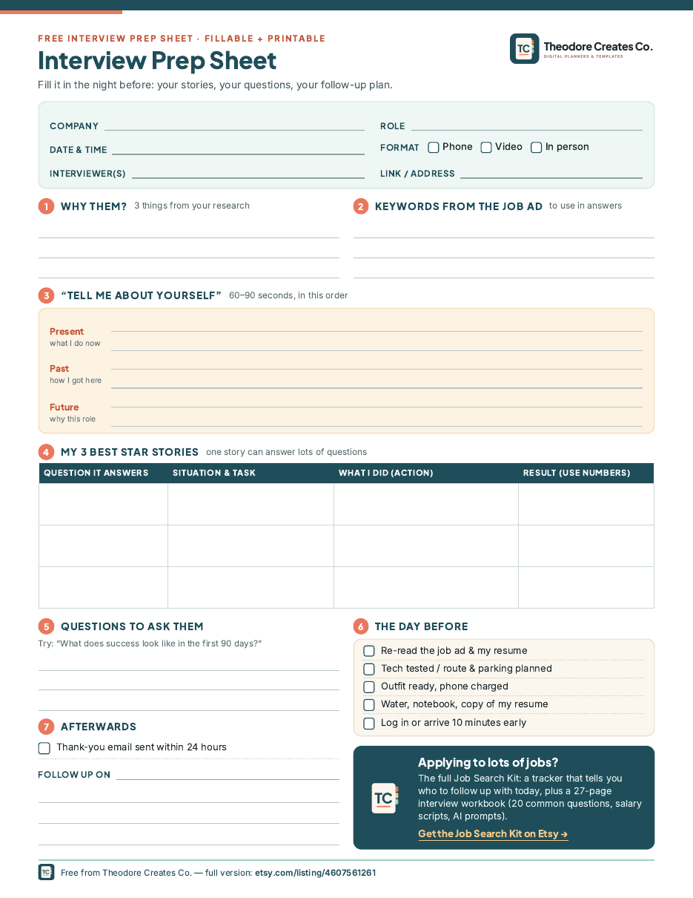

# Free Interview Prep Sheet + Job Application Tracker (lite)

Free one-page job interview prep sheet (fillable + printable PDF, A4 and US Letter) and a lite job application tracker for Excel and Google Sheets.

## What's inside
- **Interview Prep Sheet (1 page, PDF):** company, role, date & format; 3 things from your research; keywords from the job ad; a "Tell me about yourself" builder (present, past, future); 3 STAR stories; questions to ask them; a day-before checklist; and an "afterwards" section with a thank-you reminder and follow-up date
- Fillable PDF and print PDF, A4 and US Letter
- **Job Application Tracker LITE (.xlsx + .csv):** 10 columns (date applied, company, role, link, location/remote, pay range, found via, status, next step, notes), a status drop-down (Saved, Applied, Interviewing, Offer, Rejected, No reply, Withdrawn), colour-coded rows, filters and 4 counters (applications, replies, interviews, offers) plus your response rate. Works in Excel and Google Sheets.

## Download (free)
- [Fillable A4](pdf/Free-Interview-Prep-Sheet-FILLABLE-A4.pdf)
- [Fillable US Letter](pdf/Free-Interview-Prep-Sheet-FILLABLE-US-Letter.pdf)
- [Print A4](pdf/Free-Interview-Prep-Sheet-PRINT-A4.pdf)
- [Print US Letter](pdf/Free-Interview-Prep-Sheet-PRINT-US-Letter.pdf)
- [Job Application Tracker LITE (Excel / Google Sheets)](sheets/Free-Job-Application-Tracker-LITE.xlsx)
- [Tracker headers as CSV](sheets/Free-Job-Application-Tracker-LITE.csv)

> **Tip:** click a link, then press the **Download raw file** button (the ⬇ icon at the top right of the file view). Open fillable PDFs in Adobe Acrobat Reader, or a PDF app on your tablet, so the fields work.

## How to use
1. Fill in the prep sheet the night before each interview (fillable PDF in Adobe Acrobat Reader, or print it).
2. Pick STAR stories that each answer several questions (teamwork, a problem you solved, a mistake you learned from).
3. For the tracker: open the .xlsx in Excel, or upload it to Google Drive and open with Google Sheets. Add one row per application and pick a status.

## Want the full version?
This is a free sample from the **[Job Search Kit 2027](https://www.etsy.com/listing/4607561261)**: a tracker (Excel + Google Sheets) that flags who to follow up with today, with a dashboard, interviews, networking, offer comparison, weekly goals and a resume keyword checker, plus a 27-page interview prep workbook with 20 common questions, tricky questions, salary negotiation scripts and AI prompts.

More printable and digital planners: **[Theodore Creates Co. on Etsy](https://www.etsy.com/shop/TheodoreCreatesCo)**

## License
Free for personal use. Licensed under [CC BY-NC-ND 4.0](https://creativecommons.org/licenses/by-nc-nd/4.0/). Share the link freely, but please don't resell, edit or rehost the files. See [LICENSE](LICENSE).
